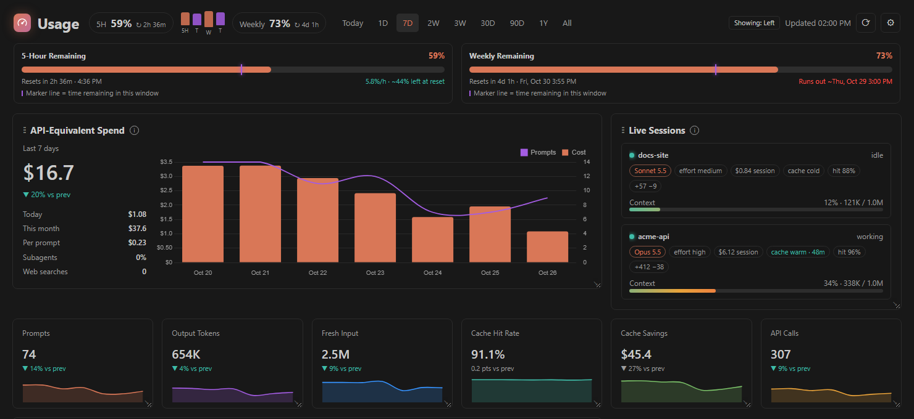
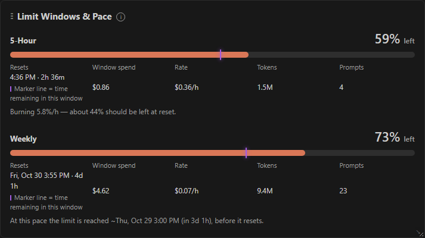
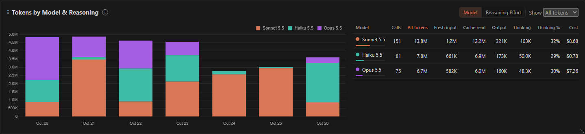
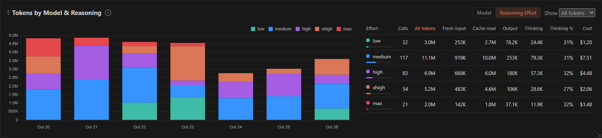
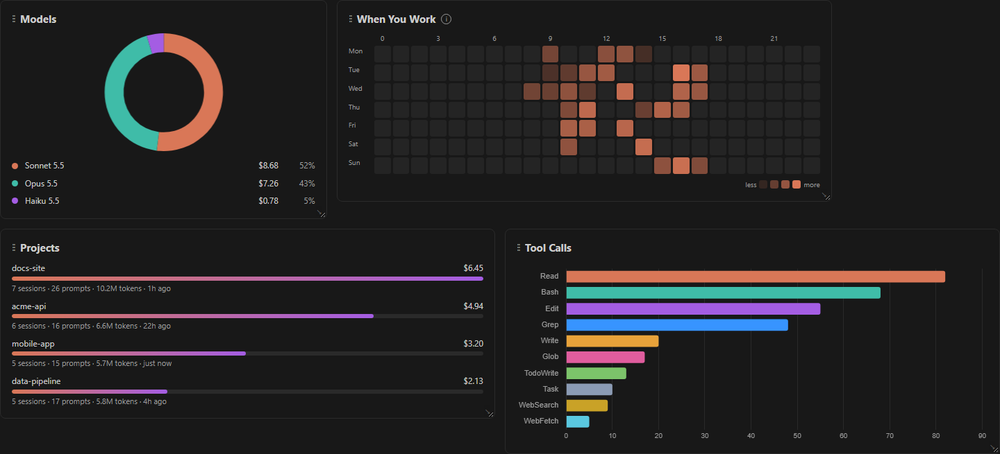
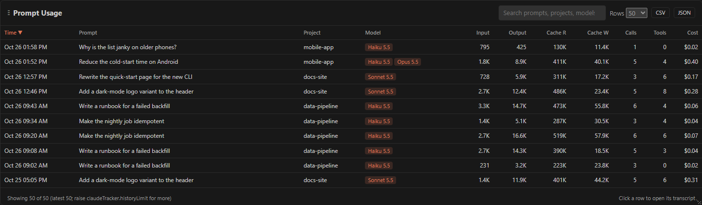
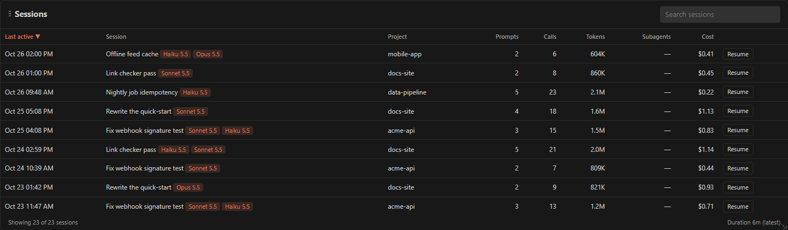
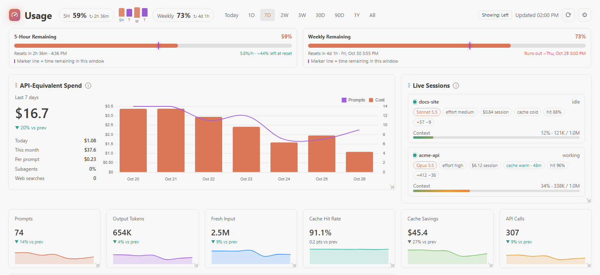
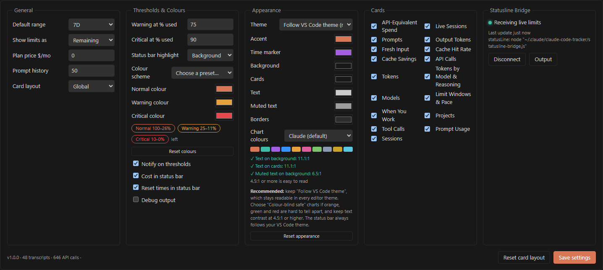

# Claude Code Token Usage Tracker

**See how fast you are using Claude Code, before you hit a limit.** Your 5-hour and weekly rate-limit windows sit in
the VS Code status bar. A dashboard in the panel shows what your usage would cost at API prices, how well prompt
caching is working, and where the tokens went: by model, reasoning effort, project, session and tool.

It reads the files Claude Code already writes on your machine. It makes no network requests and sends nothing anywhere.

> Not affiliated with or endorsed by Anthropic. Claude and Claude Code are trademarks of Anthropic, PBC.

*Screenshots use made-up sample data.*

## Get started

1. **Install** the extension and use Claude Code as usual, in the terminal or the VS Code chat panel.
2. **Look at the status bar** (bottom right). Within a few minutes it shows your windows, for example
   `5H: 64% / Rst: 19:00 · Weekly: 59% / Rst: Thu · $1.08`: what is left, when each window resets, and today's
   API-equivalent cost. Hover for pace and projected run-out time.
3. **Click it**, or run **Token Usage Tracker: Show Panel** from the Command Palette, to open the dashboard. It lives in
   the bottom panel next to Terminal and Problems.

That is all the setup the core features need. Optionally, [connect the statusline bridge](#the-optional-statusline-bridge)
for live context-window and cache details.

## Requirements

- VS Code 1.95 or later.
- Claude Code installed and used at least once, so there are transcripts to read. The extension finds the `claude`
  command on your `PATH`, or the copy bundled with the Claude Code extension for VS Code.
- **5-hour and weekly limits need a Claude Pro or Max subscription.** Claude Code only reports them for those plans.
  Without one you still get spend, tokens, caching, models, projects, sessions and tools.
- Built and used day to day on Windows. It should work on macOS and Linux, but those have had less real-world use, so
  please [report anything odd](https://github.com/jeffkararo/claude-code-token-usage-tracker/issues).

## What you get

- **Status bar:** the 5-hour and weekly windows, remaining or used (your choice), their reset times, and today's cost,
  coloured by your warning and critical thresholds. The tooltip shows burn rate and projected run-out time.
- **Limit meters with pace:** each bar has a marker for how much of the window's time is left. If usage runs ahead of
  the marker, you are burning faster than an even pace, and the dashboard says when you would run out.
- **API-equivalent spend:** an estimate at Anthropic's list prices, with input, output, cache reads, and 5-minute and
  1-hour cache writes priced separately, plus fast mode, long-context rates and web searches. Subscriptions are not
  billed per token, so this is what the same usage would cost on the API, not a bill. Enter your plan price to see how
  much value your subscription delivered.
- **Cache insight:** hit rate, dollars saved by caching, and whether each live session's cache is warm or cold, with a
  countdown to expiry.
- **Live sessions:** every running Claude Code session with its model, effort, context-window gauge, session cost, lines
  changed and cache state.
- **Prompt history:** a searchable, sortable table with the tokens and cost of each prompt, subagent work included.
  Click a row to open its transcript.
- **Sessions:** titles, prompts, calls, subagent cost, and a button that copies `claude --resume <id>`.
- **Export:** prompt history as CSV, or a usage summary without any prompt text as JSON.
- **Notifications** when a window crosses the warning or critical level.
- **Ranges:** Today, 1D (rolling 24 hours), 7D, 2W, 3W, 30D, 90D, 1Y and All.
- **Your layout:** drag and resize cards, hide the ones you do not need, and keep the layout globally or per workspace.

### Tokens by model and reasoning effort

See which models and which reasoning effort levels (low to max) your tokens go to, how much of the output was thinking,
and what each group cost. Group by model, by effort, or both.

### Projects, tools and when you work

### Every prompt and session

### Make it yours

The dashboard follows your VS Code colour theme by default, and also has dark, light and high-contrast looks.
Everything about colours and thresholds is configurable: the warning and critical levels, their colours, the chart
palette (including a colour-blind-safe one), and individual dashboard colours with a live contrast check.

## How it gets your data

| Data | Where it comes from | Setup |
| --- | --- | --- |
| Tokens, costs, prompts, projects, tools | Claude Code's transcripts in `~/.claude/projects/`, read incrementally | None |
| Running sessions | `~/.claude/sessions/` | None |
| 5-hour and weekly limits | Claude Code's local `/usage` command, run every few minutes | None |
| Live context window, prompt cache, and limits between polls | Claude Code's [statusline](https://code.claude.com/docs/en/statusline) data, saved by the bridge | Connect the bridge once (optional) |

### Limit polling

Every `claudeTracker.limitsPollMinutes` minutes (default 5; `0` turns it off), the extension runs
`claude -p /usage --output-format json --no-session-persistence`. Claude Code answers `/usage` locally: there is no
model call, no tokens are used, and no transcript is written. If a future Claude Code version ever sent `/usage` to the
model, the extension would notice the cost, stop polling and tell you. **Token Usage Tracker: Refresh Rate Limits Now**
polls on demand, and so does the dashboard's refresh button.

### The optional statusline bridge

Claude Code can pass a JSON snapshot to a `statusLine` command after each response. Run
**Token Usage Tracker: Connect Statusline Bridge** to receive it. This is the only thing the extension does that
changes your Claude Code setup, so here is exactly what happens:

1. It copies `statusline-bridge.js` to `~/.claude/claude-code-tracker/`.
2. It backs up `~/.claude/settings.json` to `settings.json.claude-tracker.bak`.
3. It sets `statusLine` to `node "<that script>"`.

If you already had a status line, the bridge saves its data and then runs your command with the same input, so yours
keeps working. **Token Usage Tracker: Disconnect Statusline Bridge** restores your previous setting. The bridge needs
Node.js on your `PATH` and writes only to `~/.claude/claude-code-tracker/`. **Disconnect before you uninstall the
extension**, or Claude Code will keep running the bridge script, which does nothing useful without the extension.

The VS Code chat panel does not run statusline commands, so the bridge only sees Claude Code running in a terminal. The
extension adds a **Claude Code** entry to the terminal **+** menu for that.

## Commands

All commands start with **Token Usage Tracker:** in the Command Palette.

| Command | What it does |
| --- | --- |
| Show Panel | Opens the dashboard |
| Refresh | Rescans transcripts |
| Refresh Rate Limits Now | Runs the `/usage` poll immediately |
| Connect / Disconnect Statusline Bridge | Adds or removes the optional bridge |
| Open Claude Code in Terminal | Opens a terminal running Claude Code |
| Export Prompt History (CSV) | Saves the prompt table, including prompt text |
| Export Usage Summary (JSON) | Saves totals only, with no prompt text |
| Show Output | Opens the extension's log |

## Settings

Most settings are in the dashboard's gear drawer. All are also in VS Code settings under **Claude Code Token Usage
Tracker**, and every one starts with `claudeTracker.`.

| Setting | Default | Purpose |
| --- | --- | --- |
| `quotaDisplay` | `remaining` | Show limits as `remaining` or `used` everywhere |
| `warningAtUsedPercent` / `criticalAtUsedPercent` | `75` / `90` | Percent of a window used at which it turns warning (orange) or critical (red) |
| `statusBarHighlight` | `background` | Fill the status-bar entry with the theme's warning colour, or colour only its text |
| `statusBarShowResets` | `true` | Show reset times in the status bar |
| `showCostInStatusBar` | `true` | Include today's cost in the status bar |
| `notifyOnThreshold` | `true` | Notify when a window crosses a threshold |
| `normalColor` / `warningColor` / `criticalColor` | *(theme)* / `#e8a23a` / `#e5484d` | Colours for the three levels |
| `theme` / `chartPalette` / `customChartColors` / `colors` | `vscode` / `default` | Dashboard colours |
| `defaultRange` | `7d` | Range the dashboard opens with |
| `planMonthlyPriceUsd` | `0` | Your plan price, to show the value you got from it |
| `pricingOverrides` | `{}` | Per-model price overrides, in USD per million tokens |
| `historyLimit` | `200` | Prompts sent to the table |
| `layoutScope` | `global` | Store the card layout globally or per workspace |
| `limitsPollMinutes` | `5` | Minutes between `/usage` reads; `0` disables |
| `claudePath` | *(empty)* | Claude Code CLI path; empty uses `PATH`, then the bundled copy |
| `claudeDir` | *(empty)* | Claude config directory; empty uses `CLAUDE_CONFIG_DIR`, then `~/.claude` |
| `pollIntervalSeconds` | `60` | Fallback rescan interval (file changes refresh sooner) |
| `outputDebug` | `false` | Verbose logging in the output channel |

Thresholds are always percent **used**, whichever way you display limits. Colours are hex (`#rgb` or `#rrggbb`).
If critical is set below warning, it is raised to match warning. Keep `theme` on `vscode` unless you have a reason:
your editor theme already has readable text and backgrounds. If you override text and background colours, keep their
contrast at 4.5:1 or higher; the settings drawer shows the ratio live.

## Privacy

Everything is local. The extension reads Claude Code's own files and makes no network requests of its own. Prompt text
stays inside the dashboard unless you export the CSV. The only process it starts is your own `claude` command, for the
local `/usage` read. See [SECURITY.md](SECURITY.md) for what it touches and how to report a problem.

## Troubleshooting

- **A window shows `N/A`.** Its reset time has passed, or Claude Code has not reported it yet. Send a prompt, or run
  **Refresh Rate Limits Now**. Rate limits are only available on Pro and Max plans.
- **A value has a `~` after it.** It is more than 30 minutes old.
- **Limits never appear.** Check **Token Usage Tracker: Show Output**. The extension needs to find the `claude` command;
  set `claudeTracker.claudePath` if it lives somewhere unusual.
- **The dashboard is empty.** It needs transcripts under `~/.claude/projects/`. If you keep Claude Code's config
  elsewhere, set `claudeTracker.claudeDir` or `CLAUDE_CONFIG_DIR`.
- **The cost does not match my bill.** It is an estimate at list prices from token counts. Subscription plans are not
  billed per token, and prices can change; override them in `claudeTracker.pricingOverrides`.
- **Something else.** [Open an issue](https://github.com/jeffkararo/claude-code-token-usage-tracker/issues). Numbers and
  screenshots with sample data are fine; please do not paste transcript contents.

## Acknowledgements

The look and layout are modelled on [VSCode Codex Tracker](https://github.com/ITFinesse/VSCode-Codex-Tracker) by
ITFinesse, rebuilt for Claude Code's data. No code is shared with that project.

## Contributing

Developer notes are in [docs/development.md](docs/development.md). Changes are listed in the
[changelog](CHANGELOG.md).

## License

[MIT](LICENSE).
